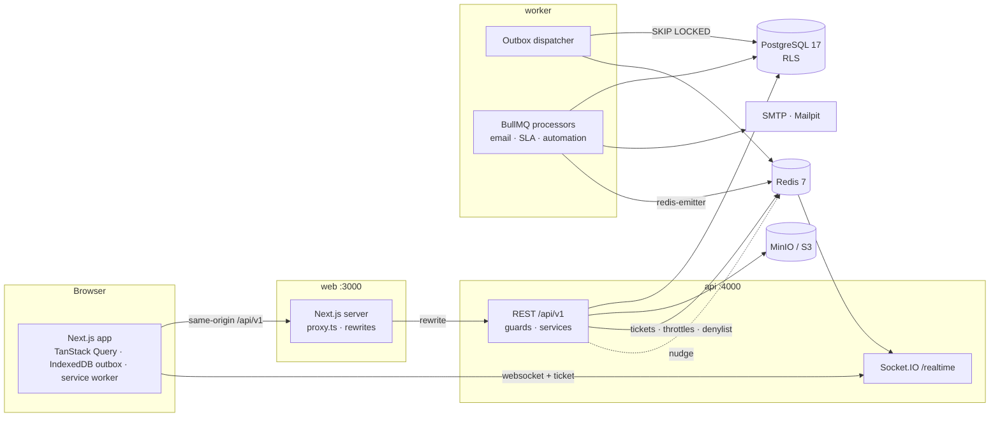

# Architecture

## System overview



FixFlow is a **modular monolith with a separately deployed worker**. `apps/api` has two entrypoints:
- `src/main.ts`: HTTP and WebSocket
- `src/worker.ts`: background processing

They share the same Nest modules (notifications, SLA, audit, work orders), so business rules exist exactly once. They ship
as one Docker image with two commands and scale independently.

### Request path

1. The browser calls `/api/v1/*` **on the web origin**. Next.js `rewrites()` proxies to `API_INTERNAL_URL`. Cookies stay
   first-party and REST needs no CORS.
2. Guard chain on every route:
   - `Throttler` (Redis storage)
   - `Auth` (JWT from the `ff_at` cookie, plus the revoked-session denylist)
   - `Csrf` (double-submit `ff_csrf` cookie against the `x-csrf-token` header on mutations)
   - `Tenant` (re-verifies the membership on each request; 60 s Redis cache, busted on membership changes)
   - `Permissions` (static role → permission matrix in `@fixflow/shared`)
3. Services run tenant work inside `db.tx(ctx, fn)`. This opens a transaction as `fixflow_app` and sets
   `app.org_id` / `app.user_id` with `set_config(…, true)`, so **Postgres RLS** confines every statement (nested writes,
   includes, raw SQL) to the organization.
4. Errors render as RFC 9457 `application/problem+json` with a `code`, field `errors[]` and a `requestId`.

Socket.IO connects directly to the API. The client first calls `POST /realtime/ticket` over REST, which returns a 60-second,
single-use ticket stored in Redis, and presents it in the handshake. The httpOnly access token is never exposed to JavaScript.

## Domain logic lives in `@fixflow/shared`

Pure functions, unit-tested exhaustively and used by both the API and the UI:

| Module | Responsibility |
|---|---|
| `workflow.ts` | State machine: `evaluateTransition(wo, actor, policy, action)` → allowed/denied plus effects; `getAvailableActions` for the UI |
| `sla.ts` | Deadline computation, warning thresholds, clock state, deterministic SLA job ids |
| `assignment.ts` | Technician ranking with human-readable reasons; auto-assign pick |
| `recurrence.ts` | Preventive-maintenance occurrences (month-end safe, org time zone) |
| `permissions.ts` | Role → permission matrix |
| `schemas/*` | Zod request schemas used by the API pipes and the web forms |

The UI shows only the actions `getAvailableActions` returns. The server re-evaluates every transition anyway.

## Work-order transitions

`POST /work-orders/:id/transitions { action, expectedVersion, … }` is the only way to change status. In **one database transaction** it:
1. Updates the row, guarded by `version` (zero rows updated → `409 VERSION_CONFLICT` with the current version).
2. Writes the status history, the audit log, SLA bookkeeping (response timestamps, a new cycle on reopen) and the in-app notification rows
   (deduplicated by `(userId, dedupeKey)`).
3. Writes **outbox events** (`email.send`, `notifications.email`, `sla.schedule`, `workOrder.autoAssign`).

After commit, the API publishes a realtime invalidation hint and a Redis "nudge" so the worker picks up the outbox immediately.

## Reliable asynchronous processing

```mermaid
sequenceDiagram
  participant API
  participant PG as Postgres
  participant W as Worker (dispatcher)
  participant BQ as BullMQ (Redis)
  participant P as Processor
  API->>PG: BEGIN; business change + OutboxEvent; COMMIT
  API-->>W: nudge (pub/sub, best effort)
  loop every 2 s and on nudge
    W->>PG: UPDATE … WHERE id IN (SELECT … FOR UPDATE SKIP LOCKED) RETURNING (30 s lease)
    W->>BQ: add(job, { jobId: outbox.id })
    W->>PG: status = DISPATCHED
  end
  BQ->>P: deliver (at least once)
  P->>PG: re-read state; guarded side effect (unique keys)
```

Guarantees and how they are achieved:

| Concern | Mechanism |
|---|---|
| Event lost if the process crashes after commit | The outbox row is committed with the business change; the dispatcher polls, and the nudge only lowers latency |
| Two dispatchers claim the same row | `FOR UPDATE SKIP LOCKED` plus a lease (`available_at`); safe with many workers |
| Same event enqueued twice | BullMQ `jobId = outbox id` ignores duplicates |
| Poison events | Exponential backoff; `DEAD` after 10 attempts, counted in `/health/ready` |
| Duplicate job execution | Processors re-read state and guard side effects with unique keys: `SlaEvent(workOrderId,type,cycle)`, `Notification(userId,dedupeKey)`, `EmailDelivery(outboxEventId,recipient)`, `WorkOrder(scheduleId,scheduledFor)` |
| Redis data loss | The SLA sweep (every minute) re-derives due warnings and breaches from Postgres; pending outbox rows are re-dispatched; repeatable jobs use fixed scheduler ids |
| Graceful shutdown | SIGTERM closes workers after in-flight jobs finish |

**Email is exactly-once up to the SMTP boundary.** `EmailDelivery(outboxEventId, recipient)` records each send, and a
redelivered job skips recipients already marked `SENT`. If the process dies between the SMTP provider accepting the message and the ledger update, a retry may send a duplicate.
That is at-least-once at the provider, which is inherent to SMTP without provider-side idempotency keys.

### SLA engine

- Deadlines (`responseDueAt`, `resolutionDueAt`) are snapshotted on the work order from the priority's `SlaPolicy`. They are recomputed
  on priority change and on reopen (`slaCycle++`).
- **Response** = time until the first `start`. **Resolution** = time until the `submittedAt` of the *approved*
  submission, so verification delay doesn't count against the technician. The ON_HOLD clock doesn't pause in v1.
- Delayed BullMQ jobs with deterministic ids `sla:{wo}:{type}:{cycle}:{due}` fire at the warning threshold and at the deadline.
  The processor is a no-op when the job is stale (cycle or due date changed, or the clock already stopped). Inserting into
  `SlaEvent` is the exactly-once gate.
- A breach notifies managers and the assignee and increments `escalationLevel` (when escalation is enabled for that priority).

### Automation (worker schedulers)

| Job | Every | What |
|---|---|---|
| `sla-sweep` | 1 min | Recover missed warnings and breaches from the database |
| `preventive-maintenance` | 5 min | Generate due schedule occurrences (idempotent per `scheduleId + scheduledFor`) and advance `nextDueAt` |
| `auto-close` | 15 min | Close resolved work after the organization's `autoCloseDays` |
| `housekeeping` | 6 h | Expire idempotency records, tokens and old sessions; prune dispatched outbox rows |

## Realtime

- Rooms: `user:{id}`, `org:{orgId}:staff`, `org:{orgId}:managers`, `org:{orgId}:wo:{id}`. Joining a work-order room re-checks
  visibility server-side.
- Payloads are **invalidation hints only** (`{ id, number, version, status }`). Clients refetch through REST, so authorization
  stays in one place. After a reconnect the client invalidates every active query to reconcile.
- The worker emits through `@socket.io/redis-emitter`; the API uses the Redis adapter, so it scales across instances.

## Offline field work

| Piece | Implementation |
|---|---|
| App shell | Hand-written service worker (`apps/web/public/sw.js`, production builds only) caches the shell and static assets |
| Read offline | `offlineFirst` query snapshots in IndexedDB, scoped to `user:org`, cleared on sign-out |
| Write offline | IndexedDB **outbox** (`lib/offline/outbox.ts`): comments, checklist toggles, start/hold/resume, photos (as blobs) |
| Exactly once | Every queued item carries a client-generated `Idempotency-Key`. The API's idempotency interceptor reserves the key first, replays the stored 2xx response for repeats, and returns 422 if the same key comes with a different payload |
| Conflicts | Transitions carry `expectedVersion`. A `409` marks the item **Conflict**, the work order's queue stops, and the technician chooses "Discard mine" or "Re-apply on latest" |
| Ordering | Replays run in creation order, per work order; retries are capped at 5 |

TanStack Query runs queries with `networkMode: 'offlineFirst'` and mutations with `'always'`, so the outbox, not
the library, decides what happens without a network.

## Files

Uploads go through the API (multipart, 10 MB):
- The type is checked by magic bytes (`file-type`) against an allowlist.
- Images are re-encoded with `sharp`, which strips EXIF/GPS, and get a thumbnail.
- Objects are stored privately under `org/{orgId}/…` in a private bucket.

Downloads stream through the API after loading the attachment row under RLS. They are sent with `nosniff`, a sandboxing CSP
and `Content-Disposition`. There are no public bucket URLs.

## Analytics

Computed in SQL inside a tenant transaction:
- RLS applies, and every query also filters `organization_id` explicitly.
- Queries use `Prisma.sql` tagged templates only.
- Buckets use `date_trunc(unit, ts AT TIME ZONE org.timezone)`, with matching bucket keys generated in TypeScript (`buckets.ts`).

Correctness is pinned by a hand-computed fixture test (`apps/api/test/integration/analytics.test.ts`).
