# Database

PostgreSQL 17 in Docker (`postgres:17-alpine`, volume `fixflow_pgdata`), with the schema managed by Prisma 7.10.
- Schema: `packages/db/prisma/schema.prisma` (28 models)
- Migrations: `packages/db/prisma/migrations`. The second migration is hand-written SQL for RLS, functions, CHECK constraints and
  guarded grants.

## Roles

| Role | Attributes | Used by |
|---|---|---|
| `fixflow_owner` | LOGIN, owns the databases and schema | `prisma migrate deploy` only |
| `fixflow_app` | LOGIN, **NOBYPASSRLS**, DML only | Every tenant request (`db.tx`, `db.userTx`) |
| `fixflow_system` | LOGIN, **BYPASSRLS**, DML only | The audited cross-tenant paths in [SECURITY.md](SECURITY.md) |

`packages/db/scripts/apply-roles.mjs` (`pnpm db:roles`) creates or updates the roles, databases (`fixflow`, `fixflow_test`,
`fixflow_shadow`) and grants. It is idempotent and never drops anything, and the compose `migrate` service runs it on every start.
Runtime roles can't run DDL or read `_prisma_migrations`.

## Tenancy model

- Every tenant table has `organization_id` and an RLS policy:
  `USING (organization_id = app_current_org()) WITH CHECK (organization_id = app_current_org())`.
- User-owned tables (sessions, tokens, the user's own memberships and notifications) use `app_current_user()`.
- `app_current_org()` / `app_current_user()` read `current_setting('app.org_id' | 'app.user_id', true)`. Unset means NULL,
  so **zero rows** are returned (fail closed).
- `Database.tx(ctx, fn)` sets both settings with `set_config(…, true)` (transaction-local) before running `fn`, so a pooled
  connection never leaks context. The RLS tests run with pool size 1 to prove this.
- **Composite foreign keys** `(organization_id, x_id) → (organization_id, id)` on every child relation (work order → category,
  location, asset, schedule; asset → location, category; location → parent; all work-order children). People are referenced through
  `Membership(organization_id, user_id)`. A cross-tenant `connect`, nested create or raw insert is rejected by the database even if
  application code is wrong.

## Entity-relationship diagram (core)

```mermaid
erDiagram
  User ||--o{ Membership : has
  User ||--o{ Session : has
  User ||--o{ UserToken : has
  Organization ||--o{ Membership : has
  Organization ||--o{ Invitation : sends
  Organization ||--o{ Location : owns
  Organization ||--o{ Category : owns
  Organization ||--o{ Asset : owns
  Organization ||--o{ SlaPolicy : configures
  Organization ||--o{ MaintenanceSchedule : plans
  Organization ||--o{ AuditLog : records
  Organization ||--o{ OutboxEvent : emits
  Membership ||--o{ TechnicianSkill : has
  Category ||--o{ TechnicianSkill : "skill in"
  Location ||--o{ Location : parent
  Location ||--o{ Asset : contains
  Category ||--o{ Asset : classifies
  Category ||--o| ChecklistTemplate : "default checklist"
  ChecklistTemplate ||--o{ ChecklistTemplateItem : has
  WorkOrder }o--|| Category : "is about"
  WorkOrder }o--o| Location : at
  WorkOrder }o--o| Asset : on
  WorkOrder }o--o| Membership : "requested by"
  WorkOrder }o--o| Membership : "assigned to"
  WorkOrder }o--o| MaintenanceSchedule : "generated by"
  WorkOrder ||--o{ WorkOrderAssignment : history
  WorkOrder ||--o{ WorkOrderStatusHistory : history
  WorkOrder ||--o{ WorkOrderComment : has
  WorkOrder ||--o{ WorkOrderChecklistItem : has
  WorkOrder ||--o{ Attachment : has
  WorkOrder ||--o{ ResolutionSubmission : has
  WorkOrder ||--o{ SlaEvent : has
  ResolutionSubmission ||--o{ Attachment : evidence
  User ||--o{ Notification : receives
  OutboxEvent ||--o{ EmailDelivery : delivers
```

Not shown: `NotificationPreference`, `IdempotencyRecord`.

## Key tables

| Table | Notes |
|---|---|
| `organizations` | Name, unique slug, industry, IANA time zone, `work_order_seq` (per-org `WO-0042` numbers, allocated with `UPDATE … RETURNING` inside the creating transaction), and the policy toggles |
| `memberships` | `unique(organization_id, user_id)`, role (`ORG_ADMIN`, `MANAGER`, `TECHNICIAN`, `REQUESTER`), status (`ACTIVE`, `SUSPENDED`), job title, availability |
| `locations` | One self-referencing hierarchy (SITE, BUILDING, FLOOR, ROOM, AREA), with allowed parent types enforced in the service, a rotatable `public_report_token`, and `archived_at` |
| `assets` | `unique(organization_id, asset_tag)`, status, warranty, `public_report_token` |
| `work_orders` | Status, priority, source (`WEB`, `QR`, `GUEST_QR`, `SCHEDULED`), snapshotted SLA deadlines and clock timestamps, `sla_cycle`, `escalation_level`, `reopen_count`, `rework_count`, `version` (optimistic concurrency), `unique(schedule_id, scheduled_for)` |
| `resolution_submissions` | Notes, labor, parts; `outcome` (`PENDING`, `APPROVED`, `REJECTED`) plus reviewer, review time and review note (one review per submission) |
| `sla_events` | `unique(work_order_id, type, cycle)`, the exactly-once gate for warnings and breaches |
| `notifications` | `unique(user_id, dedupe_key)` |
| `outbox_events` | `PENDING`, `DISPATCHED` or `DEAD`; attempts, `available_at` (lease and backoff), last error. Nullable org for account emails |
| `email_deliveries` | `unique(outbox_event_id, recipient)`: email ledger |
| `idempotency_records` | `unique(user_id, key)`, request hash, stored status and body, expiry |
| `audit_logs` | Actor, action, entity, JSONB metadata, IP, user agent; indexed by `(org, created_at)` and `(org, entity_type, entity_id)` |

## Invariants enforced by CHECK constraints

| Constraint | Rule |
|---|---|
| `work_orders_has_place` | Location or asset is required |
| `work_orders_positive` | `number > 0`, `version ≥ 1`, `sla_cycle ≥ 0` |
| `work_orders_due_order` | Resolution due ≥ response due |
| `work_orders_assignee_when_assigned` | Assigned, in-progress, on-hold and pending-verification statuses require an assignee |
| `work_orders_requester_or_guest` | Requester required unless source is `GUEST_QR` or `SCHEDULED` |
| Policy, SLA and schedule bounds | Positive SLA minutes, warning percent in range, skill level 1–3, schedule interval ≥ 1 |
| Location | Can't be its own parent |
| Users | Emails are stored lower-case |

## Operations

| Task | Command |
|---|---|
| Apply roles and migrations | `pnpm db:migrate` (or the compose `migrate` service) |
| New migration | `pnpm db:migrate:dev --name <change>`, then review the SQL |
| Demo data | `pnpm db:seed`. Idempotent; `SEED_RESET=true` recreates only the three demo organizations |
| Inspect | `pnpm db:studio` |
| Wipe the local dev DB | `CONFIRM_RESET=yes pnpm db:reset`. **Destructive**; refuses in production or against remote hosts |
| Backup and restore | See [DEPLOYMENT.md](DEPLOYMENT.md#backup-and-restore) |
